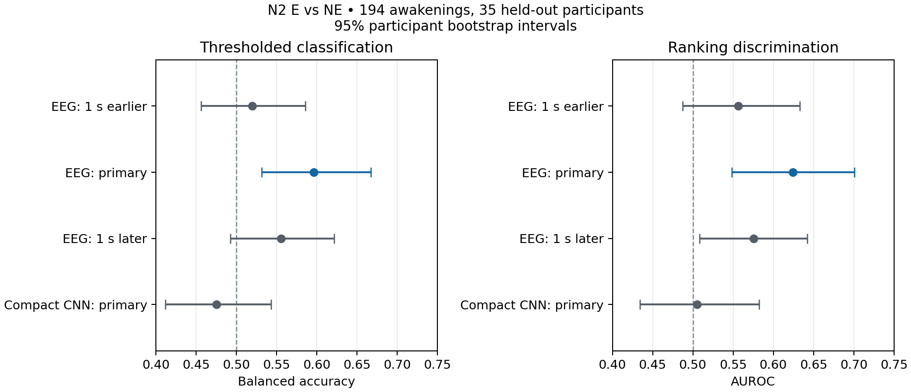

# Phase 4 — measured results and interpretation

**Run date:** 26 October 2026. **Status:** Within-study, participant-held-out experiments completed on Tononi Serial Awakenings v3. These are predictions of reports after awakening, not dream content or a direct measure of consciousness. The original [study methods](https://doi.org/10.1038/nn.4545) describe two-minute pre-awakening extraction; the exact alarm sample is not marked in the released EDFs. The working 30-second EEG window is seconds 85–115 relative to the start of the nominal 120-second record. The one-second endpoint ambiguity and its sensitivity test are part of the interpretation. The data source is [Tononi v3](https://doi.org/10.26180/23306054.v3) in the [DREAM catalogue](https://doi.org/10.26180/22133105).

## Cohort and safeguards

| Gate | E: recalled | WR: experience without recalled content | NE: no reported experience | Total |
|---|---:|---:|---:|---:|
| Catalogue/package, N2 | 124 | 56 | 107 | 287; 39 participants |
| Excluded by header mismatch or fixed peak/flat rule | 18 | 6 | 19 | 43 |
| Eligible, primary nominal window | 106 | 50 | 88 | 244; 35 participants |

Five participant-23 EDFs have an incompatible 300-second/256-channel format (3 E, 2 NE). A prespecified gross-artifact rule rejects 38 other windows. The three timing windows (one second earlier, primary, one second later) retain **the same 244 cases and 35 participants**. The primary binary test uses E versus NE only: 194 awakenings from 35 participants. WR remains a separately trained exploratory three-class task. Every recording is N2, so stage detection cannot explain the within-cohort comparison.

Five outer folds hold out whole participants; no person appears on both sides of an outer or inner split. The binary outer test-fold counts (NE/E, participants) are 17/20 (8), 19/23 (8), 16/21 (7), 18/22 (6), and 18/20 (6). The same folds and cases are used for the timing comparisons; the CNN uses the same binary outer folds. The three-class task has 8–11 WR awakenings per outer fold. Hyperparameter tuning, data-adaptive scaling, early stopping and calibration use training-side participants only. Reported 95% intervals resample whole participants from pooled out-of-fold predictions 2,000 times; they do not capture all uncertainty from model refitting or the single-laboratory design.

## Primary E versus NE results

| Predictor/window | Macro F1 | Balanced accuracy | AUROC | AUPRC for E | Brier score ↓ |
|---|---:|---:|---:|---:|---:|
| Training-fold prior only; N2 stage is constant | 0.353 | 0.500 | 0.485 | 0.537 | **0.248** |
| Band-power logistic regression; 1 s earlier | 0.515 | 0.520 | 0.556 | 0.599 | 0.274 |
| Band-power logistic regression; primary | **0.593** | **0.596** | **0.624** | **0.652** | 0.265 |
| Band-power logistic regression; 1 s later | 0.552 | 0.556 | 0.576 | 0.624 | 0.283 |
| Compact 1D CNN; primary | 0.474 | 0.475 | 0.505 | 0.557 | 0.251 |

E prevalence is 106/194 = **0.546**. AUPRC must be read beside that prevalence. The prior-only model predicts the more common E class for everyone, hence 0.500 balanced accuracy and low macro F1. Its pooled AUROC can deviate from exactly 0.500 because its training-fold prevalence changes between folds. The band-power model's primary-window confusion matrix, rows actual NE/E and columns predicted NE/E, is `[[56, 32], [47, 59]]`: NE recall 56/88 = 0.636 and E recall 59/106 = 0.557. It misses 47 recalled-experience reports and incorrectly labels 32 no-experience reports as E. Class-weighted training does not make the error rates equal.

For the primary logistic model, the participant bootstrap 95% intervals are macro F1 **[0.527, 0.661]**, balanced accuracy **[0.531, 0.667]**, and AUROC **[0.548, 0.701]**. The paired primary-minus-prior interval for balanced accuracy is **[0.031, 0.167]**. This supports modest *within-study, held-out-participant discrimination* for the prespecified nominal window. It does not establish cross-laboratory transfer, exact alarm alignment, or a brain mechanism.

**How to read the figure:** Each dot is a score over 194 held-out awakenings; each bar is a 95% interval from resampling the 35 participants, not individual EEG seconds. The vertical line at 0.5 is a chance reference for balanced accuracy and AUROC. The blue primary band-power model is strongest here. Overlapping bars should not be used as a paired significance test; the paired estimates below use the same awakenings. These intervals also do not make the original timing assumption certain.

## Timing sensitivity and model comparison

Relative to the primary band-power model, moving the input one second **earlier** reduces balanced accuracy by **0.077** (paired participant bootstrap interval for primary minus earlier **[0.023, 0.134]**) and AUROC by **0.068** (**[0.014, 0.115]**). Moving it one second **later** reduces balanced accuracy by **0.041** (interval **[-0.014, 0.100]**) and AUROC by **0.049** (**[0.001, 0.094]**). The same cases, groups, labels and outer folds were checked before comparing. These shifts do not establish a physiological one-second effect: model instability, signal quality near the window edges and nominal timing ambiguity also remain possible. A claim that performance is robust to the endpoint choice would be too strong.

The CNN has **21,706 parameters**, used CPU PyTorch 2.10.0, and early-stopped after 1–10 epochs across folds. The band-power model exceeds it by **0.119** macro F1; the paired 95% interval for band power minus CNN is **[0.023, 0.222]**. CNN AUROC is close to 0.5. The deep model adds no demonstrated value on this cohort. A more elaborate architecture would be a new exploratory experiment, not an automatic remedy for 194 correlated awakenings.

The uncalibrated band-power model's Brier score (**0.265**, lower is better) is worse than the prior-only probability model's **0.248** despite better discrimination. Training-side sigmoid calibration lowers its held-out Brier to **0.239**; this point estimate is not a proven improvement because no paired calibration interval or independent external calibration set has been established. The fixed confidence rule retains **157/194 = 80.9%** of cases; calibrated macro F1 on that subset is **0.593** versus **0.561** on all cases. The subset is easier by construction, so this cannot be called a general accuracy gain. The prior-only macro F1 on those same retained cases is **0.354**. Reliability and precision–recall curves are reproducibly generated into `outputs/binary_baseline/`, which stays out of Git.

## Exploratory three-class test

| Model, E/WR/NE | Macro F1 | Balanced accuracy | WR precision | WR recall | WR one-vs-rest AUROC | WR AUPRC |
|---|---:|---:|---:|---:|---:|---:|
| Prior-only (always E) | 0.202 | 0.333 | 0 | 0 | 0.459 | 0.191 |
| Band-power logistic regression | 0.315 | 0.316 | 0.208 | 0.220 | 0.516 | 0.228 |
| Compact CNN | 0.323 | 0.332 | 0.190 | 0.300 | 0.502 | 0.199 |

WR prevalence is 50/244 = **0.205**. Both models' WR precision/AUPRC are near prevalence; the one-vs-rest AUROCs are near 0.5. The band-power WR recall interval is **[0.110, 0.341]** under participant resampling. Its confusion matrix (actual rows NE/WR/E; predicted columns NE/WR/E) is `[[35,15,38],[12,11,27],[44,27,35]]`. Only **11 of 50** WR reports are correctly assigned. The paired macro-F1 interval for logistic minus CNN includes zero (**[-0.081, 0.069]**). The evidence does **not** support a reliable three-class or E-versus-WR claim; the category can reflect uncertain recall and is not a verified intermediate consciousness state.

## What we can claim, and what remains

The defensible course-project finding is narrow: a conventional band-power model gives modest discrimination of E versus NE reports for new participants **within one N2 study and one nominal pre-awakening window**. The effect changes under one-second window shifts, calibrated probabilities need further checking, the CNN does not improve on the conventional baseline, and WR is poorly distinguished. Participant grouping removes direct same-person train/test overlap; it does not remove protocol, recording, artifact or report biases. Signal-quality exclusions could also bias the cohort, as the rejection counts differ by report category.

No leave-one-study-out or LODE transfer experiment has been run: its montage, reference, timing and report labels have not passed a harmonization audit. Do not describe these results as cross-site generalization. Channel attribution maps are not interpreted as causal brain locations. The study does not read minds or reconstruct dream content.

**Publication assessment:** This is a rigorous, interpretable course-project result with clear negative and sensitivity findings. A journal submission would need a stronger contribution, preferably independently harmonized external data and a refreshed literature review, with timing and calibration limitations resolved or quantified. No journal quartile or acceptance is implied.

### Reproduction and files

Code, fixed seeds, source versions, hashes, split counts and deidentified metrics are in the repository. See [`results/phase4_metrics.json`](../results/phase4_metrics.json) for exact numbers and participant bootstrap intervals. Raw EDFs, sample-level probabilities and subject IDs remain outside Git. To reproduce after acquiring the pinned public package, run the manifest and three preprocess commands with `--window-shift-seconds -1`, `0`, and `1`; lock common cases with `python -m dream_recall.sensitivity`; fit the baseline for each with `--case-list`; then run the CNN and comparison modules. The [README](../README.md) will maintain exact commands. The timing evidence JSON is local and contains the cited methods-supported nominal assumption rather than an exact alarm marker.
